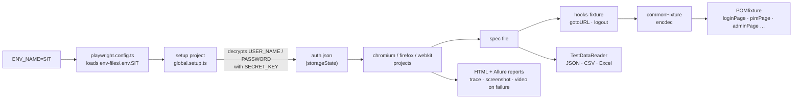
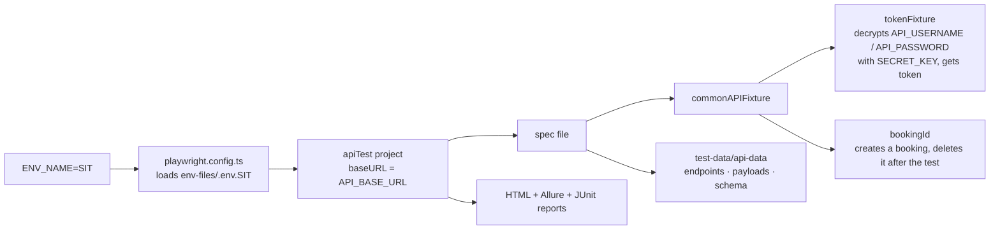
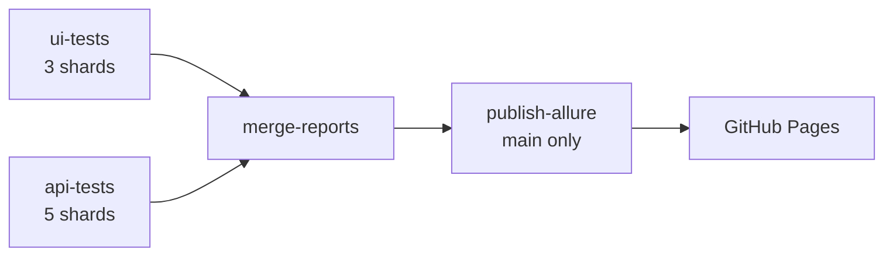

# Playwright Automation Framework

A TypeScript hybrid automation framework with two test suites:

- **UI tests** for the OrangeHRM web app, using the Page Object Model and data-driven tests fed from JSON, CSV and Excel.
- **API tests** for the Restful Booker API, using Playwright's `request` fixture.

Both suites share layered fixtures, encrypted credentials, per-environment config, HTML/Allure/JUnit reports and a GitHub Actions pipeline.

**Stack:** `@playwright/test` 1.63 · TypeScript (strict) · Allure + HTML reports · Faker · SheetJS · csv-parse · crypto-js (AES) · ESLint + Prettier

## Contents

- [Onboarding](#onboarding)
- [Folder structure](#folder-structure)
- [How a test runs](#how-a-test-runs)
- [CI pipeline](#ci-pipeline)
- [What makes it hybrid, scalable, reusable and maintainable](#what-makes-it-hybrid-scalable-reusable-and-maintainable)
- [Concepts and how we implemented them](#concepts-and-how-we-implemented-them)
- [Test Data](#test-data)
- [Writing a new test](#writing-a-new-test)
- [Command reference](#command-reference)
- [Future plans](#future-plans)

## Onboarding

From a fresh clone to a green run in about ten minutes.

1. **Install prerequisites:** Node.js 20 or later, Git, and VS Code with the Playwright Test and ESLint extensions. Java is needed only to open Allure reports locally.

2. **Clone and install:**

   ```powershell
   git clone <repo-url>
   cd PlaywrightAutomationFramework
   npm ci
   npx playwright install --with-deps
   ```

   SheetJS installs from its own CDN tarball, already pinned in `package.json` (see [Setup note](#setup-note)).

3. **Create the environment files.** They are git-ignored. Copy [`env-files/.env.example`](env-files/.env.example) to `env-files/.env.dev` (and `.env.SIT`, etc.), then ask a team member for the values or encrypt your own (step 4):

   ```ini
   # env-files/.env.dev  (and .env.SIT, etc.)
   BASE_URL=https://<orangehrm-host>
   USER_NAME=<AES-encrypted username>
   PASSWORD=<AES-encrypted password>
   API_BASE_URL=https://<restful-booker-host>
   API_USERNAME=<AES-encrypted username>
   API_PASSWORD=<AES-encrypted password>
   ```

   [`playwright.config.ts`](playwright.config.ts) loads `env-files/.env.${ENV_NAME}` and falls back to `.env.dev`.

4. **Set the secret key.** Credentials are stored encrypted. The key that decrypts them, `SECRET_KEY`, is never written to a file. Set it in your shell for the session:

   ```powershell
   # PowerShell
   $env:SECRET_KEY = "<team secret>"
   # Git Bash / macOS / Linux
   export SECRET_KEY="<team secret>"
   ```

   To encrypt a new value with the same key set, run `npm run encrypt -- "<value>"` ([`scripts/encrypt.ts`](scripts/encrypt.ts)) and paste the output into the env file.

5. **Run your first test:**

   ```powershell
   npm run test_SIT_ch_hl        # SIT, Chromium, headless
   npx playwright show-report     # open the HTML report
   ```

   The `setup` project logs in once and saves the session to `auth-file/.auth/auth.json`. Every browser project then starts already logged in.

6. **Before you push:**

   ```powershell
   npm run lint
   npm run format:check
   ```

   Lint catches a missing `await` (`no-floating-promises`) and a left-over `test.only`.

## Folder structure

Each folder has one job. Tests describe behaviour; everything else lives in a layer underneath them.

### At a glance

| Folder | What goes here | UI | API |
|---|---|---|---|
| `tests/` | Spec files: what to test | `ui-tests/` | `api-tests/` |
| `pages/` | Page objects: locators and actions per screen | ✅ | |
| `fixtures/` | Ready-made objects injected into tests | ✅ | ✅ |
| `utils/` | Reusable helpers: API clients, data reader, encryption, mocks | ✅ | ✅ |
| `test-data/` | Input data: JSON, CSV, Excel and Faker factories | `ui-data/` | `api-data/` |
| `scripts/` | Tools run outside Playwright (data converter, encrypt) | ✅ | ✅ |
| `env-files/` | Per-environment URLs and encrypted credentials (git-ignored) | ✅ | ✅ |
| `.github/workflows/` | CI pipeline | ✅ | ✅ |

### Full tree

```
PlaywrightAutomationFramework/
├── tests/
│   ├── ui-tests/                      OrangeHRM UI specs, one per feature
│   │   ├── global.setup.ts            Logs in once, saves storageState
│   │   ├── login.spec.ts              Real login flow (clears storageState)
│   │   ├── PIM.spec.ts · admin.spec.ts · sideMenu.spec.ts
│   │   ├── PIMMock.spec.ts            UI with mocked API responses
│   │   ├── addEmployee.spec.ts        Data-driven from JSON
│   │   ├── addEmployeeValidation.spec.ts   Data-driven from CSV
│   │   └── hrNewJoiners.spec.ts       Data-driven from Excel → JSON
│   └── api-tests/                     Restful Booker API specs
│       ├── restful-booker-auth.spec.ts      Token / auth checks
│       ├── restful-booker-api.spec.ts       CRUD on bookings
│       ├── restful-booker-E2E.spec.ts       Create → read → update → delete flow
│       ├── restful-booker-negative.spec.ts  Invalid input and error codes
│       └── schema.spec.ts                   Response schema validation
├── pages/                             Page objects (UI only)
│   ├── LoginPage · DashboardPage · SideMenuPage
│   └── PIMPage · AdminPage
├── fixtures/                          Layered dependency injection
│   ├── POMfixture.ts                  UI: page objects
│   ├── commonFixture.ts               UI: + utilities (encdec, apiMock)
│   ├── hooks-fixture.ts               UI: + setup/teardown hooks (gotoURL, logout)
│   └── commonAPIFixture.ts            API: tokenFixture, bookingAPI, bookingId (auto-cleanup)
├── utils/
│   ├── CommonAPIUtils.ts              API: gets the auth token
│   ├── BookingAPI.ts                  API: create / get / delete booking
│   ├── APIMockUtils.ts                UI: mock, fail or abort network calls
│   ├── TestDataReader.ts              One reader for JSON / CSV / Excel
│   ├── uniqueID.ts                    Time-based ID shared by the UI specs
│   └── encryptionDecryption.ts        AES encrypt / decrypt
├── test-data/
│   ├── api-data/                      Endpoints, payloads, negative cases, schema, mock data
│   └── ui-data/
│       ├── employee.json · addEmployeeValidation.csv
│       ├── excel/hr-new-joiners.xlsx  Business-owned source
│       ├── employe.factory.ts         Faker-based dynamic data
│       ├── types.ts                   EmployeeData type
│       └── generated/                 Converter output (git-ignored)
├── scripts/
│   ├── convert-new-joiners.ts         Validates Excel, writes JSON
│   └── encrypt.ts                     npm run encrypt -- "<value>"
├── env-files/                         .env.dev, .env.SIT (git-ignored), .env.example
├── auth-file/                         Saved login session (git-ignored)
├── .github/workflows/playwright.yml   CI: ui-tests and api-tests jobs
├── playwright.config.ts               Projects, reporters, timeouts, env loading
├── eslint.config.mjs · .prettierrc · tsconfig.json
└── package.json                       npm scripts per env and browser
```

### Playwright projects

| Project | Runs | Depends on |
|---|---|---|
| `setup` | `global.setup.ts`: logs in and saves the session | none |
| `chromium` · `firefox` · `webkit` | UI specs, already logged in | `setup` |
| `apiTest` | Everything in `tests/api-tests/`, with `baseURL = API_BASE_URL` | none |

## How a test runs

The config picks the environment, the setup project logs in once, and each spec asks for only the fixtures it needs.

### UI test



### API test



## CI pipeline

[`.github/workflows/playwright.yml`](.github/workflows/playwright.yml) runs the suites on GitHub Actions.

### When it runs and what it runs

| Trigger | Tests run |
|---|---|
| Push or pull request to `main` | `@smoke` only |
| Nightly at 11:30 PM IST (`schedule`) | Everything |
| Manual, from the **Actions** tab (`workflow_dispatch`) | Pick a browser (`chromium` / `firefox` / `webkit`) and an optional tag or text to grep; empty runs everything |

A new run on the same branch cancels the older one (`concurrency`).

### Jobs



| Job | What it does |
|---|---|
| `ui-tests` | Lint and type check, install the browser, convert the HR Excel sheet, run the UI project on 3 shards (`chromium` by default) |
| `api-tests` | Run the `apiTest` project on 5 shards (no browser needed) |
| `merge-reports` | Combine all shards into one HTML + JUnit report per suite and one Allure results folder. Runs even when tests fail |
| `publish-allure` | Build the Allure report, keep the trend history from the previous run, and deploy it to GitHub Pages. Runs only on `main`, never for a PR |

### Sharding and merged reports

- Each job uses `strategy.matrix` with `--shard=<index>/<total>`, so the shards run on separate machines at the same time. `fail-fast: false` lets every shard finish even if one fails.
- In CI, [`playwright.config.ts`](playwright.config.ts) switches to the `blob` reporter. A blob holds a shard's results with its traces, screenshots and videos. Locally you still get the HTML, Allure and JUnit reports.
- `merge-reports` runs `npx playwright merge-reports --reporter html,junit` on the blobs. UI and API are merged separately because both suites name their blob files `report-<shard>.zip`.
- Merging needs the same Playwright version as the shards, which `npm ci` guarantees.

### Artifacts on each run

| Artifact | Contents | Kept |
|---|---|---|
| `ui-playwright-report` · `api-playwright-report` | One merged HTML report and JUnit XML per suite | 14 days |
| `allure-results` | Allure results from every shard of both suites | 14 days |
| `ui-test-results-shard-N` | Raw traces and videos per UI shard | 14 days |
| `*-blob-report-shard-N` | Shard blobs, input to the merge | 1 day |

### Allure report on GitHub Pages

The latest Allure report from `main` is published at `https://<owner>.github.io/PlaywrightAutomationFramework/` (owner in lowercase). The link is also shown on the run summary.

- **One-time setup:** **Settings → Pages → Build and deployment → Source → GitHub Actions**.
- Each deploy replaces the previous report. Earlier runs live on in the trend charts, because `publish-allure` copies `history/*.json` from the live site before it builds.
- On a free plan, Pages needs a public repo, so the report is public. It can contain screenshots and videos of failed tests. Credentials stay encrypted and never appear in it.

**Secrets:** the `.env` files are git-ignored, so CI reads the same values from GitHub Secrets instead. Add them under **Settings → Secrets and variables → Actions → New repository secret**:

| Secret | Used by |
|---|---|
| `SECRET_KEY` | both jobs |
| `BASE_URL` · `USER_NAME` · `PASSWORD` | `ui-tests` |
| `API_BASE_URL` · `API_USERNAME` · `API_PASSWORD` | `api-tests` |

Use the same encrypted values as in `.env.SIT`, and store the key on its own without quotes or spaces.

## What makes it hybrid, scalable, reusable and maintainable

### Hybrid: several approaches in one framework

- **Page Object Model** for UI structure.
- **Data-driven** tests from JSON, CSV and Excel through one reader.
- **Dynamic data** from Faker when the values don't matter, only uniqueness.
- **Fixture-based** setup and teardown instead of scattered `beforeEach` blocks.
- **Tag-driven** selection (`@smoke`, `@regression`, Jira IDs) on top of all of it.

### Scalable: grows without rework

- New test cases are new data rows, not new code. HR can add a joiner in Excel.
- New environments are a new `.env.<NAME>` file, with no code change.
- New browsers are a new `projects` entry; mobile and branded channels are already stubbed in the config.
- Login runs once per run via `storageState`, so suite time grows with tests, not with logins.
- The config is CI-aware: retries, workers and reporters switch on `process.env.CI`.
- `fullyParallel` is on, so tests run in parallel within a file and shards split by test instead of by spec file.
- CI shards the suites across machines (3 UI, 5 API) and merges them back into one report.

### Reusable: write once, use everywhere

- Page methods such as `addEmployeeWithDetails` and `selectEmployeeFromAutoSuggest` serve many specs.
- Fixtures inject page objects, so no spec calls `new LoginPage(page)`.
- `readTestData<T>()` is one typed entry point for every data format.
- `EmployeeData` is shared by the JSON spec, the Excel spec and the converter.
- `fieldInput()` and `errorFor()` map a field name to its input and error message, so one validation test covers every field.

### Maintainable: cheap to change, hard to break

- A UI change is fixed in one page object, not in every spec.
- Role- and label-based locators (`getByRole`, `getByPlaceholder`) survive markup changes.
- Strict TypeScript, type-aware ESLint and Prettier keep style and async correctness consistent.
- Bad data fails fast with a clear message: missing file, unknown field, or the Excel row number that is invalid.
- Every test carries an ID, tags and a Jira annotation, so a failure traces back to a requirement.

## Concepts and how we implemented them

| Concept | How it is implemented | Where |
|---|---|---|
| Page Object Model | One class per screen. Locators are `readonly` fields set in the constructor; methods are business actions with built-in waits and assertions. | [`pages/`](pages/) |
| Custom fixtures | `test.extend()` chained in three layers: page objects → utilities → hooks. Specs import from the layer they need. | [`fixtures/`](fixtures/) |
| Fixture hooks | `gotoURL` runs before the test and checks the dashboard loads, which catches a stale session. `logout` runs its code after `use()` as teardown. | [`hooks-fixture.ts`](fixtures/hooks-fixture.ts) |
| Session reuse | A `setup` project logs in and saves `storageState`. Browser projects depend on it and load `auth.json`. `login.spec.ts` clears it to test the real login. | [`global.setup.ts`](tests/ui-tests/global.setup.ts), [`playwright.config.ts`](playwright.config.ts) |
| Multi-environment | `cross-env ENV_NAME=…` plus `dotenv` loads the matching file; `baseURL` comes from `BASE_URL`. | [`playwright.config.ts`](playwright.config.ts) |
| Credential security | Usernames and passwords are stored AES-encrypted; `SECRET_KEY` is passed at run time. Clear errors when the key is missing or wrong. | [`encryptionDecryption.ts`](utils/encryptionDecryption.ts) |
| Data-driven testing | `readTestData<T>()` picks the parser from the extension and always returns an array of rows; a `for…of` loop creates one test per row. | [`TestDataReader.ts`](utils/TestDataReader.ts) |
| Business-owned data | Excel sheet with business-friendly columns and dropdowns. A converter keeps `Run = Y` rows, validates them, maps them to `EmployeeData` and writes JSON before Playwright starts. | [`convert-new-joiners.ts`](scripts/convert-new-joiners.ts) |
| Dynamic test data | Faker factory for names, usernames and passwords, plus a time-based `uniqueID()` so reruns don't clash on the shared demo site. | [`employe.factory.ts`](test-data/ui-data/employe.factory.ts), [`uniqueID.ts`](utils/uniqueID.ts) |
| Tags and traceability | Tags from the data files (`@smoke`, `@regression`, `@pim`); a feature-level tag and `Feature` / `Jira ID` annotations on `describe` and `test`. | [`hrNewJoiners.spec.ts`](tests/ui-tests/hrNewJoiners.spec.ts) |
| Readable steps | `test.step()` groups actions into named steps that show in the HTML and Allure reports. | data-driven specs |
| Web-first assertions | `expect(locator).toHaveCount / toContainText / toHaveURL` with auto-retry and no fixed sleeps (lint warns on `waitForTimeout`). | pages and specs |
| Reporting and debugging | HTML, Allure and JUnit reporters locally; `blob` per shard in CI, merged with `merge-reports`. Trace on first retry; screenshot and video kept only on failure. Allure published to GitHub Pages. | [`playwright.config.ts`](playwright.config.ts), [`playwright.yml`](.github/workflows/playwright.yml) |
| CI/CD | GitHub Actions with push, PR, nightly and manual triggers; tag-based selection; lint and type check gate; matrix sharding; merged reports. | [`playwright.yml`](.github/workflows/playwright.yml) |
| Code quality | Strict TS, `typescript-eslint` with type information, `eslint-plugin-playwright`, and Prettier last to avoid rule conflicts. | [`eslint.config.mjs`](eslint.config.mjs) |

### Fixture layering in practice

```ts
// POMfixture.ts – page objects are created per test and injected by name
export const test = baseTest.extend<POMFixture>({
  pimPage: async ({ page }, use) => { await use(new PIMPage(page)); },
  // ...
});

// hooks-fixture.ts – code before use() is setup, code after is teardown
gotoURL: async ({ page, loginPage }, use) => {
  await loginPage.gotoOrangeHRM();
  await expect(page).toHaveURL(/dashboard/);
  await use();
},

// spec – ask only for what the test needs
test('Delete an added Employee', async ({ gotoURL, pimPage }) => { /* ... */ });
```

## Test Data

All test data, whether JSON, CSV or Excel, is read through one utility: [`utils/TestDataReader.ts`](utils/TestDataReader.ts).

```ts
import { readTestData } from '../../utils/TestDataReader';

const rows = readTestData<MyRowType>('test-data/<file>.<json|csv|xlsx|xls>', 'OptionalSheetName');
```

- Paths are relative to the project root, so every spec uses the same path style.
- The parser is chosen from the **file extension**. You never pick a reader yourself.
- The result is always an **array of rows**. Each row becomes one test in a `for…of` loop.
- If the file is missing, the error shows the full path that was tried.
- An unsupported extension throws `Unsupported test data format "<ext>"`.

### How each file type is handled

| | `.json` | `.csv` | `.xlsx` / `.xls` |
|---|---|---|---|
| Parser | `JSON.parse` | `csv-parse` | SheetJS (`xlsx`) |
| Row keys | Object keys | Header row (row 1) | Header row (row 1) of the sheet |
| Value types | Kept as in the JSON file (arrays, nested objects, booleans, numbers) | **Always strings** | **Always strings**, as shown in Excel (formatted dates, formula results) |
| Blank values | Whatever the JSON holds | `''` | `''`; a column is never missing from a row |
| Blank rows | n/a | Skipped | Skipped |
| Extras | A single object is wrapped into a one-row array | Values trimmed; Excel's BOM removed | Sheet chosen by name; defaults to the first sheet |
| Example | [`employee.json`](test-data/ui-data/employee.json) → [`addEmployee.spec.ts`](tests/ui-tests/addEmployee.spec.ts) | [`addEmployeeValidation.csv`](test-data/ui-data/addEmployeeValidation.csv) → [`addEmployeeValidation.spec.ts`](tests/ui-tests/addEmployeeValidation.spec.ts) | [`hr-new-joiners.xlsx`](test-data/ui-data/excel/hr-new-joiners.xlsx) → [`convert-new-joiners.ts`](scripts/convert-new-joiners.ts) |

CSV and Excel both produce flat rows of strings. In the spec, convert numbers and booleans yourself, and split comma-separated lists such as tags. JSON keeps nested, typed data, so moving a dataset between JSON and CSV/Excel needs a mapping step.

### Which format to use

| Source | Use it when | How it reaches the test |
|---|---|---|
| JSON | Testers own the data and it has nested or typed fields | Read directly in the spec |
| CSV | You have flat tables with many rows, such as validation cases | Read directly in the spec, then convert types |
| Excel, read directly | You have a simple sheet whose columns already match the code names | `readTestData('file.xlsx', 'Sheet')` in the spec |
| Excel, converted first | The business owns the sheet | A converter script validates the sheet and writes JSON before the run (see below) |

### Business-owned Excel: HR new-joiner batch

HR maintains [`test-data/ui-data/excel/hr-new-joiners.xlsx`](test-data/ui-data/excel/hr-new-joiners.xlsx), sheet `NewJoiners`, using business-friendly column names:

| Run | Test ID | Title | Tags | First Name | Middle Name | Last Name | Create Login | Username Prefix | Login Status |
|---|---|---|---|---|---|---|---|---|---|
| Y | TC_HR_001 | Joiner without login | @smoke, @hr | Ravi | | Kulkarni | N | | |
| Y | TC_HR_002 | Joiner with login | @regression, @hr | Neha | S | Joshi | Y | neha | Enabled |

- Set `Run` to `N` to leave a row out of the run without deleting it.
- `Tags` are comma-separated.
- `Create Login`, `Run` and `Login Status` have dropdowns in the sheet.

The flow:

```
hr-new-joiners.xlsx ──npm run data:new-joiners──► test-data/ui-data/generated/new-joiners.json ──► hrNewJoiners.spec.ts
```

[`scripts/convert-new-joiners.ts`](scripts/convert-new-joiners.ts) does the following:

1. Reads the sheet with `readTestData`.
2. Keeps only the rows where `Run = Y`.
3. Validates each row:
   - the required fields are filled in;
   - no `Test ID` appears twice;
   - when `Create Login = Y`, `Username Prefix` is set and `Login Status` is `Enabled` or `Disabled`.
4. Maps the business column names to the `EmployeeData` type in [`test-data/types.ts`](test-data/types.ts).
5. Writes the JSON. The generated folder is git-ignored; the Excel file is the source of truth.

If any row is invalid, the script stops before the browser opens and names each problem by its Excel row number:

```
❌ test-data/ui-data/excel/hr-new-joiners.xlsx has 1 problem(s):
  Row 3: "Login Status" must be Enabled or Disabled, got "Active"
```

Run it:

```powershell
npm run data:new-joiners   # convert only
npm run test:new-joiners   # convert, then run the batch on SIT / Chromium
```

> **Why not convert in `globalSetup`?** Playwright loads the spec files, and so reads their test data, **before** `globalSetup` runs. Converting there would mean the first run uses an old JSON file, or finds none at all. Always convert before `playwright test` starts.

### Adding a new data-driven test

1. Put the data file in `test-data/`.
2. Define a row type for it, either in the spec or in `test-data/types.ts` if more than one file uses it.
3. Call `readTestData<RowType>('test-data/<file>')` at the top of the spec and create one `test()` per row.
4. For CSV or Excel, convert string values to the types you need inside the spec.
5. If the business owns the file, add a converter script in `scripts/` and an `npm run data:<name>` script, following the new-joiner example.

### Setup note

SheetJS is installed from the SheetJS CDN, because the `xlsx` package on npm is outdated and has known vulnerabilities:

```powershell
npm i -D https://cdn.sheetjs.com/xlsx-0.20.3/xlsx-0.20.3.tgz
```

## Writing a new test

1. **Add or extend a page object** in `pages/<Feature>Page.ts`. Prefer `getByRole` / `getByPlaceholder`, and keep waits and success checks inside the method.
2. **Register it as a fixture** in the `POMFixture` type and the `extend()` block of [`fixtures/POMfixture.ts`](fixtures/POMfixture.ts).
3. **Pick your data:** Faker for throw-away values, or a JSON/CSV/Excel file in `test-data/` for defined cases (see [Adding a new data-driven test](#adding-a-new-data-driven-test)).
4. **Write the spec.** Import `test` and `expect` from `fixtures/hooks-fixture`. Name tests `TC_<AREA>_<NNN> - title`, add tags and a Jira ID annotation, and wrap each phase in `test.step()`.
5. **Keep it independent.** Each test creates its own data with a unique suffix and never relies on another test's state.
6. **Lint, run, check the report:** `npm run lint`, run it headed once to watch it, then check that the steps read well in the report.

## Command reference

| Command | What it does |
|---|---|
| `npm test` | Convert the HR Excel sheet (via `pretest`), then run every project on the default env (dev) |
| `npm run test_SIT_ch_hl` | SIT, Chromium, headless |
| `npm run test_SIT_ch_headed` | SIT, Chromium, headed |
| `npm run test_dev_ff_headed` | dev, Firefox, headed |
| `npm run test_api` | SIT, API tests only |
| `npm run test:new-joiners` | Convert the HR Excel sheet to JSON, then run the batch on SIT / Chromium |
| `npm run data:new-joiners` | Convert and validate the Excel sheet only |
| `npm run encrypt -- "<value>"` | AES-encrypt a value with `SECRET_KEY` for the env files |
| `npx playwright test --grep @smoke` | Run by tag (also works for `@HRM-1000`) |
| `npx playwright test --ui` | Interactive UI mode for writing and debugging |
| `npm run allure:serve` | Build and open the Allure report from `allure-results` |
| `npm run lint` · `npm run lint:fix` | ESLint check / auto-fix |
| `npm run format` · `npm run format:check` | Prettier write / check |


## Future plans

### Next

- **CI improvements:** move lint and type check into their own job that the test jobs wait on, so lint runs once instead of once per shard; add `npm run format:check` (commit `.prettierrc` first, it is git-ignored today).
- **Clean-up:** use one naming style for scripts (e.g. `test:sit:chromium`), and rename `employe.factory.ts` and `loginToOrgangeHRM`.

### Soon

- **API-backed setup and cleanup:** create and delete employees through the API, so UI tests check only the UI and leave no data behind.
- **`BasePage`** for shared helpers (toast check, table row lookup, confirm delete) that `PIMPage` and `AdminPage` both repeat today.

### Later

- **Test management sync:** push results to Jira / Xray using the existing `Jira ID` annotations.
- **More coverage:** Leave, Time, Recruitment and My Info modules; mobile viewports and branded browsers (already stubbed in the config).
- **Visual and accessibility checks:** `toHaveScreenshot()` on key screens and `@axe-core/playwright` scans.
- **Notifications:** post a run summary with a report link to Teams or Slack.
- **Docker image** for identical local and CI runs.
